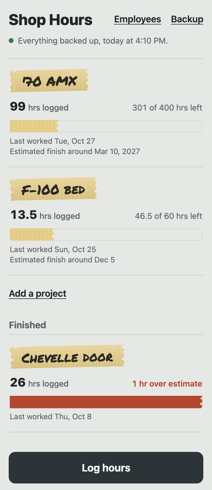
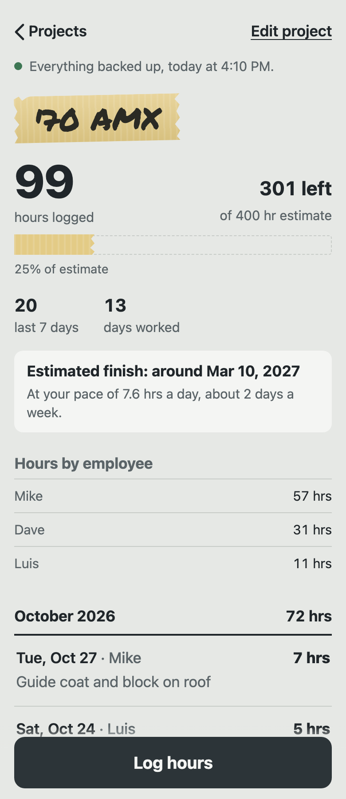
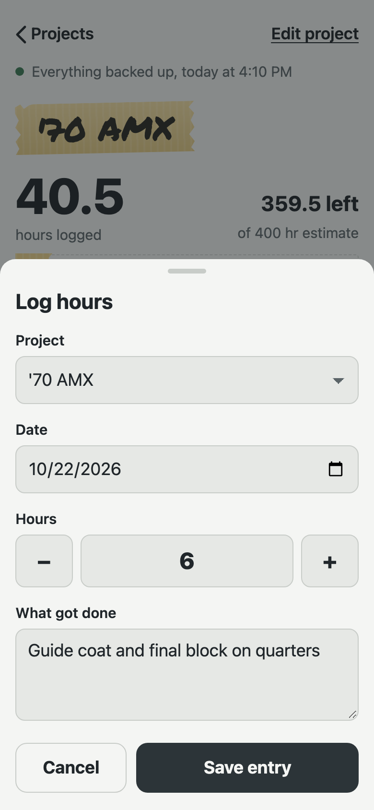

# Shop Hours

Log the hours you put into each car or job, right from your phone, and see how many hours are left on your estimate.

**Free. No account, no subscription, no ads.** Every entry is backed up to a Google Sheet in *your own* Google account. Nobody else ever sees your hours.

<p>
  
  
  
</p>

- **Works with no signal.** Log hours in a garage with no bars. The app saves everything on the phone and backs it up as soon as you're back online.
- **Your own backup.** Every entry, edit and delete goes to your Google Sheet. Deleted entries are kept on a separate tab, so nothing is ever lost.
- **Estimates.** Give a job a rough total (say 400 hours) and the app shows what's left, with a masking-tape progress bar.
- **iPhone and Android.** It runs in the phone's web browser and installs on your Home Screen like an app. There's nothing to buy or download from an app store.

---

## Get it

It takes about 15 minutes, and you only do it once.

**You need:** a Google account (any Gmail address works), a computer for step 1, and your phone.

### Step 1: Make your backup sheet (on a computer, about 10 minutes)

Use a computer for this step. Google's script editor is very hard to use on a phone.

1. Sign in to Google, then go to **[sheets.new](https://sheets.new)**. A blank spreadsheet opens.
   Click *Untitled spreadsheet* at the top left and name it **Shop Hours Backup**.
2. In the sheet's menu, click **Extensions → Apps Script**. A code editor opens in a new tab.
3. Open the **[backup script](backup-script/Code.gs)** in another tab and click the **copy button** (two overlapping squares, top right of the code).
   Go back to the code editor, select everything that's already there and delete it, then paste.
   Click the **Save** icon (the floppy disk).
4. Click **Run**. If the box next to Run says something other than **setup**, pick **setup** first.
   Google asks for permission:
   - Click **Review permissions** and pick your account.
   - You'll see **"Google hasn't verified this app."** Click **Advanced**, then **Go to Untitled project (unsafe)**.
   - If you see checkboxes, tick them all. Then click **Allow** (or **Continue**).

   > **Is that safe?** Yes. Google shows that warning for any script a person writes for their own use, rather than one from a company Google has checked. The script runs in your account and can only open this one spreadsheet.

   When it's done, the log at the bottom says *"Done. Your backup key is …"*.
5. Click **Deploy → New deployment**. Click the gear next to *Select type* and choose **Web app**. Set:
   - **Execute as:** Me
   - **Who has access:** Anyone

   Click **Deploy**. *Anyone* is what lets the app on your phone reach the sheet without signing in. Your backup key keeps everyone else out.
6. Copy the **Web app URL** it shows you (it ends in `/exec`) and click **Done**.
7. Go back to your spreadsheet's tab. There's a new **Phone setup** tab with your **backup key**. Paste the Web app URL into the box next to **Web app link**, so the two are saved together.

**Now get both onto your phone.** The easiest way is to email the Web app link and the backup key to yourself. You can also open the sheet in the Google Sheets app on your phone and copy them from the Phone setup tab.

### Step 2: Install the app on your phone (about 2 minutes)

The app's address is **https://emum.github.io/shop-hours/**

**iPhone**
1. Open that address in **Safari**.
2. Tap **Share** (the square with the arrow) → **Add to Home Screen**. If there's an **Open as Web App** switch, leave it on. Tap **Add**.
3. From now on, **always open Shop Hours from the Home Screen icon**, never from a Safari tab. On iPhone, the icon and Safari keep separate copies of your entries.

**Android**
1. Open that address in **Chrome**.
2. Tap the **⋮** menu → **Install app** (on some phones it says **Add to Home screen**). Tap **Install**.
3. Open Shop Hours from the new icon.

### Step 3: Connect the backup (about 1 minute)

1. In the app, tap **Backup** (top right).
2. Paste in the **Web app link** and the **backup key**, then tap **Save and test**.
   It should say ***Connected to "Shop Hours Backup"***.
3. Tap **Projects**, add your first car or job, and log some hours. A minute later the entry shows up on the sheet's **Entries** tab.

That's it.

---

## Using it

- **Log hours:** tap **Log hours**, pick the project, set the hours (the **−** and **+** buttons go by half an hour), and say what got done.
- **Fix a mistake:** tap any entry to change or delete it.
- **Estimates:** tap **Edit project** to add or change the estimated total at any time. Rough guesses are fine.
- **Finished a job:** **Edit project → Mark as finished** moves it to the Finished list. You can move it back.
- **The backup line** at the top of the screen tells you where things stand. *Everything backed up* means the sheet has it all. *2 changes waiting to back up* means there's no signal right now. They'll go out on their own once the phone is online.
- **In the sheet:** the **Projects** tab totals your logged hours and hours left for each job. The **Entries** tab has every entry. The **Deleted** tab keeps a copy of anything you delete.
- **Spreadsheet file:** **Backup → Export CSV** saves all your entries as a file you can email or open in Excel or Numbers.

Make your changes in the app, not by editing rows in the sheet. The sheet is the backup copy. Changes typed into it don't flow back to your phone.

## New phone, or deleted the app

1. Install the app again (Step 2) and connect the backup (Step 3).
2. Tap **Backup → Restore from Google Sheets**. All your projects and entries come back.

**Before deleting the app or switching phones, check that it says *Everything backed up*.** Deleting the app also deletes anything that hasn't been backed up yet.

## If something goes wrong

| The app says… | What to do |
|---|---|
| *That doesn't look like a Google Apps Script link* | Copy the **Web app URL** again (Step 1, part 6). It starts with `https://script.google.com/macros/s/` and ends in `/exec`. |
| *That link didn't answer like the backup script* | Usually **Who has access** isn't set to **Anyone**. In Apps Script, go to **Deploy → Manage deployments**, click the pencil, set it to **Anyone**, pick **New version**, and click **Deploy**. |
| *This backup script has no key yet* | Do Step 1, part 4 (click **Run**). |
| *The backup key does not match* | Copy the key again from the **Phone setup** tab of your sheet. |
| *Couldn't reach Google* | Check that the phone is online and try again. |
| *Changes waiting to back up* | Nothing's wrong. There's no signal right now, and they'll be sent automatically. Tap **Try now** to send them right away. |
| *Google took too long to answer* | Google was slow. The app tries again by itself. |

**Entries are missing on iPhone:** make sure you opened the app from the Home Screen icon and not from Safari.

## Updating the backup script

The app updates itself. The backup script only needs updating if a change note here says so. To update it:

1. Open your sheet, then **Extensions → Apps Script**. Replace all the code with the new [backup script](backup-script/Code.gs) and click **Save**.
2. Click **Deploy → Manage deployments**, then the pencil icon. Set **Version** to **New version** and click **Deploy**.

Your Web app link and backup key stay the same, so there's nothing to change on your phone.

## Your data

- Your hours and notes are stored on your phone and in your own Google Sheet, and nowhere else.
- The app is a web page hosted for free on GitHub Pages. GitHub serves the app's files, like any website, but your entries never go there. The app has no tracking or analytics.
- Keep your backup key to yourself. Anyone with both the Web app link and the key could add rows to your sheet.

---

## For tinkerers

Everything is plain HTML and JavaScript with no build step:

```
app/              the app (published to GitHub Pages on every push to main, after the tests pass)
backup-script/    Code.gs, the Google Apps Script backup
tests/            unit tests for the script, and a browser test of the app against a fake Google
```

```bash
python3 -m http.server 8765 --directory app   # run it at http://localhost:8765
node tests/script.test.js                     # backup script tests (Node 18+)
cd tests && python3 e2e.py                    # browser tests (pip install playwright && playwright install chromium)
```

[CLAUDE.md](CLAUDE.md) explains how syncing and restoring work, and the rules that keep data safe. To host your own copy, fork this repo, then turn on **Settings → Pages → Source: GitHub Actions**.

## License

[MIT](LICENSE). Use it, change it and share it freely. The Permanent Marker font in `app/marker.woff2` has its own font license.
